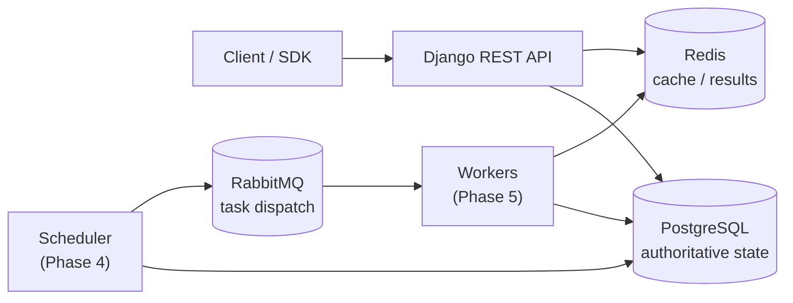

# FlowForge

[](https://github.com/Abolfazlrwm/flowforge/actions/workflows/ci.yml)
[](LICENSE)
[](pyproject.toml)

A distributed workflow orchestration engine for DAG-shaped jobs, built on
Django, PostgreSQL, RabbitMQ and Redis. FlowForge aims to make the *hard*
parts of distributed execution explicit — leases, fencing tokens, a
transactional outbox and at-least-once delivery — instead of hiding them
behind a task decorator.

> **Status: Phase 0 of 11 — engineering foundation only.**
> There is no workflow engine yet. What exists today is the platform skeleton:
> configuration, health probes, container images, and a CI pipeline that
> builds and boots the whole stack. The feature table below lists exactly what
> is implemented and nothing more.

## Why this exists

Most Python task queues make the happy path trivial and the failure path
invisible. When a worker is killed mid-task, when a broker drops a publish
confirmation, or when two schedulers race for the same row, a naive
`delay()`-and-forget design silently double-executes or loses work.

FlowForge is an attempt to build the boring, correct version: state machines
with explicit transition tables, conditional `UPDATE` transitions, leases with
fencing tokens so a resurrected worker cannot overwrite newer results, and a
transactional outbox so a database commit and a broker publish cannot
disagree. The design is written down before it is built — see
[`docs/architecture/`](docs/architecture/) and [`docs/adr/`](docs/adr/).

## Architecture



Today only the API shell, the datastores and the health probes are wired.
The scheduler and worker boxes are placeholders served by Celery (ADR-007).

## Design guarantees and limits

These are the properties the design targets. **None of them are implemented
yet** — they are listed so the gap between the goal and the code is explicit,
not implied.

| Property | Target | Status |
|----------|--------|--------|
| Delivery semantics | **At-least-once**, never exactly-once | Planned (Phase 4–5) |
| Duplicate suppression | Idempotent handlers + lease fencing tokens | Planned (Phase 5–6) |
| Publish/commit atomicity | Transactional outbox | Planned (Phase 4) |
| Concurrent claiming | `SELECT … FOR UPDATE SKIP LOCKED` | Planned (Phase 4) |
| Stale-writer protection | Monotonic fencing token checked on write | Planned (Phase 5) |
| Failure visibility | Explicit `DEAD` state + manual requeue | Planned (Phase 6) |

**Explicit non-goals:** exactly-once execution, arbitrary user-supplied Python
in workers, and running untrusted code. FlowForge will never claim exactly-once
delivery; the failure model documents why that is unachievable and what is
offered instead.

## Quickstart (60 seconds)

Requires Docker with Compose v2.

```bash
git clone https://github.com/Abolfazlrwm/flowforge.git
cd flowforge
docker compose up --build -d

# Both probes should answer:
curl -s http://localhost:8000/health/live/    # {"status": "alive", ...}
curl -s http://localhost:8000/health/ready/   # {"status": "ready", "checks": {...}}
```

Or run everything locally without Docker:

```bash
uv sync --locked --extra dev
cp .env.example .env
uv run python manage.py migrate
uv run python manage.py runserver
```

`make demo` performs the Docker path and asserts both probes.

## What is implemented

| Capability | State |
|------------|-------|
| Django 5.1 project with split settings (`base`/`dev`/`test`/`prod`) | Implemented |
| PostgreSQL, Redis, RabbitMQ configuration via `django-environ` | Implemented |
| `SECRET_KEY` required whenever `DEBUG` is off | Implemented |
| Liveness probe `GET /health/live/` | Implemented |
| Readiness probe `GET /health/ready/` (PostgreSQL, Redis, RabbitMQ) | Implemented |
| Multi-stage Docker image, non-root user, healthcheck | Implemented |
| Docker Compose stack (db, redis, rabbitmq, web, scheduler, worker) | Implemented |
| CI: lint, format, mypy, migration check, tests, compose smoke test | Implemented |
| Dependency lock file (`uv.lock`) used by CI and the image | Implemented |
| Domain models, state machines | **Not implemented** (Phase 1) |
| Workflow definition validation | **Not implemented** (Phase 2) |
| REST API, auth, pagination | **Not implemented** (Phase 3) |
| Scheduler, outbox, leases, fencing tokens | **Not implemented** (Phases 4–5) |
| Retries, DLQ, reaper | **Not implemented** (Phase 6) |
| Multi-tenancy, RBAC, audit log | **Not implemented** (Phase 8) |
| Metrics, tracing, dashboards | **Not implemented** (Phase 9) |
| SDK, CLI | **Not implemented** (Phase 10) |

Full plan: [`docs/development/ROADMAP.md`](docs/development/ROADMAP.md).

## Development

```bash
make install      # uv sync --locked --extra dev
make check        # ruff check + ruff format --check + mypy + pytest
make test         # pytest tests/unit --cov
make demo         # docker compose up + assert both health probes
```

Without `make`:

```bash
uv run ruff check .
uv run ruff format --check .
uv run mypy flowforge core api --ignore-missing-imports
uv run pytest tests/unit -v --cov
```

## Documentation

- [Architecture overview](docs/architecture/overview.md)
- [Development setup](docs/development/setup.md)
- [Roadmap](docs/development/ROADMAP.md) · [Progress](docs/development/PROGRESS.md)
- [Architecture decisions](docs/adr/) · [Decisions index](docs/development/DECISIONS.md)
- [Audit report](docs/development/AUDIT_REPORT.md) · [Naming analysis](docs/development/NAMING_ANALYSIS.md)

## Benchmarks

None yet. No performance claim will appear here until it is measured on
stated hardware with a committed benchmark script.

## Contributing

See [CONTRIBUTING.md](CONTRIBUTING.md). Conventional Commits, tests for every
change, and `make check` before opening a PR.

## Security

See [SECURITY.md](SECURITY.md) for the disclosure process.

## License

Apache-2.0 — see [LICENSE](LICENSE).
