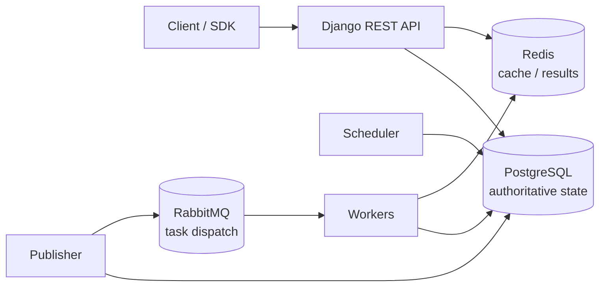

# FlowForge

[](https://github.com/Abolfazlrwm/flowforge/actions/workflows/ci.yml)
[](https://codecov.io/gh/Abolfazlrwm/flowforge)
[](LICENSE)
[](pyproject.toml)

A distributed workflow orchestration engine for DAG-shaped jobs, built on
Django, PostgreSQL, RabbitMQ and Redis. FlowForge aims to make the *hard*
parts of distributed execution explicit — leases, fencing tokens, a
transactional outbox and at-least-once delivery — instead of hiding them
behind a task decorator.

> **Status: Phases 0–10 released (`v0.1.0` … `v0.11.0`). Phase 11 — production
> hardening — is the current work toward `v1.0.0`.**
> A workflow can be described, validated, published, and triggered over HTTP; the
> scheduler promotes dependency-satisfied tasks into a transactional outbox, the
> publisher delivers them to RabbitMQ with publisher confirms, and a worker claims
> each task run with a fencing token, runs a trusted handler, and writes the
> durable outcome before acking. A failed task is retried with exponential backoff
> and jitter, a task that exhausts its policy becomes `DEAD` and waits for an
> operator, and `docs/architecture/failure-model.md` maps every failure mode to a
> test that proves the recovery. On top of that sit multi-tenancy and RBAC, an
> append-only audit log, observability, and a Python SDK and CLI — and, as the
> current phase, the operational surface: Kubernetes, backups, high availability,
> and a signed, SBOM'd supply chain.
> The feature table below lists exactly what is implemented and nothing more.

## Why this exists

Most Python task queues make the happy path trivial and the failure path
invisible. When a worker is killed mid-task, when a broker drops a publish
confirmation, or when two schedulers race for the same row, a naive
`delay()`-and-forget design silently double-executes or loses work.

FlowForge is an attempt to build the boring, correct version: state machines
with explicit transition tables, conditional `UPDATE` transitions, leases with
fencing tokens so a resurrected worker cannot overwrite newer results, and a
transactional outbox so a database commit and a broker publish cannot
disagree. The design is written down before it is built — see
[`docs/architecture/`](docs/architecture/) and [`docs/adr/`](docs/adr/).

## Architecture



All boxes are wired. The scheduler never publishes directly — it writes a
transactional-outbox row in the same transaction that made the task dispatchable,
and the publisher talks to the broker. The worker claims the task run with a
fencing token, runs a trusted handler, writes the outcome, and only then acks; the
scheduler completes the workflow run when its tasks resolve.

## Design guarantees and limits

These are the properties the design targets. The status column says which are
implemented today, so the gap between the goal and the code is explicit rather
than implied.

| Property | Target | Status |
|----------|--------|--------|
| Delivery semantics | **At-least-once**, never exactly-once | Verified end to end against RabbitMQ in CI (Phase 4–5) |
| Duplicate suppression | Idempotent handlers + lease fencing tokens + outbox `dispatch_id` | Fencing tokens (Phase 1), `dispatch_id` (Phase 4), claim-based dedup (Phase 5) |
| Publish/commit atomicity | Transactional outbox | Implemented and verified against a real broker in CI (Phase 4) |
| Concurrent claiming | Conditional `UPDATE … WHERE state = ?` — the database decides the winner | Implemented (Phase 1) |
| Stale-writer protection | Monotonic fencing token checked on write | Implemented (Phase 1) |
| Lease recovery | Expired leases routed into the retry lifecycle, token bumped | Implemented (Phase 4; reworked in Phase 6) |
| Failure visibility | Explicit `DEAD` state + manual requeue | Implemented (Phase 6) |
| Bounded retries | Per-task policy, exponential backoff with full jitter, attempts counted | Implemented (Phase 6) |

**Explicit non-goals:** exactly-once execution, arbitrary user-supplied Python
in workers, and running untrusted code. FlowForge will never claim exactly-once
delivery; the failure model documents why that is unachievable and what is
offered instead.

## Quickstart (60 seconds)

Requires Docker with Compose v2.20 or newer (`service_completed_successfully`
gates the application services on a one-shot migration container).

```bash
git clone https://github.com/Abolfazlrwm/flowforge.git
cd flowforge
docker compose up --build -d

# Both probes should answer:
curl -s http://localhost:8000/health/live/    # {"status": "alive", ...}
curl -s http://localhost:8000/health/ready/   # {"status": "ready", "checks": {...}}
```

Or run everything locally without Docker:

```bash
uv sync --locked --extra dev
cp .env.example .env
uv run python manage.py migrate
uv run python manage.py runserver
```

`make demo` performs the Docker path and asserts both probes.

## What is implemented

| Capability | State |
|------------|-------|
| Django 5.2 LTS project with split settings (`base`/`dev`/`test`/`prod`) | Implemented |
| PostgreSQL, Redis, RabbitMQ configuration via `django-environ` | Implemented |
| `SECRET_KEY` required whenever `DEBUG` is off | Implemented |
| Liveness probe `GET /health/live/` | Implemented |
| Readiness probe `GET /health/ready/` (PostgreSQL, Redis, RabbitMQ) | Implemented |
| Multi-stage Docker image, non-root user, healthcheck | Implemented |
| Docker Compose stack (db, redis, rabbitmq, one-shot migrate, web, scheduler, publisher) | Implemented |
| CI: lint, format, mypy, migration check, tests, compose smoke test | Implemented |
| Dependency lock file (`uv.lock`) used by CI and the image | Implemented |
| State machines with validated transition tables, enforced at import time | Implemented (Phase 1) |
| Atomic conditional-`UPDATE` transitions; a lost race returns `False`, not an error | Implemented (Phase 1) |
| Leases with fencing tokens, so a resurrected worker's write matches zero rows | Implemented (Phase 1) |
| UUID primary keys and six `CHECK` constraints mirroring the domain rules | Implemented (Phase 1) |
| Workflow definitions as validated value objects, with a dependency graph | Implemented (Phase 2) |
| Duplicate-key, unknown-dependency and cycle rejection (iterative detection) | Implemented (Phase 2) |
| JSON Schema validation with JSONPath errors; versioned, lossless publishing | Implemented (Phase 2) |
| REST API with cursor pagination, filtering and a single error envelope | Implemented (Phase 3) |
| Token and JWT authentication; staff-only publishing; per-owner run reads | Implemented (Phase 3) |
| Idempotent triggers via `Idempotency-Key`, backed by a unique index | Implemented (Phase 3) |
| Committed OpenAPI document, with a CI job that fails on drift | Implemented (Phase 3) |
| Scheduler: promotes dependency-satisfied tasks and starts the run | Implemented (Phase 4) |
| Transactional outbox: one row per dispatch generation, in the same transaction | Implemented (Phase 4) |
| Publisher: drains the outbox with `FOR UPDATE SKIP LOCKED` and publisher confirms | Implemented (Phase 4) |
| Lease reaper: expired leases routed to `retrying` (or `dead`), fencing token bumped | Implemented (Phase 4; reworked in Phase 6) |
| Worker: manual ack, prefetch, trusted handlers, lease + fencing, heartbeat | Implemented (Phase 5) |
| Graceful SIGTERM: finish and ack the in-flight message before exiting | Implemented (Phase 5) |
| Scheduler completes the run when its tasks resolve | Implemented (Phase 5) |
| Per-task retry policy: exponential backoff with a cap and full jitter | Implemented (Phase 6) |
| Dead-letter: `DEAD` is terminal; `manage.py requeue_dead` is the way back | Implemented (Phase 6) |
| Handler results persisted in `TaskRun.result` | Implemented (Phase 6) |
| Opt-in idempotency keys for handler replay | Implemented (Phase 6) |
| Failure-injection tests (kill worker/scheduler, lost ack, broker and DB restart) | Implemented (Phase 6) |
| Branching / fan-in, sandboxed expressions, cron triggers, run cancellation | Implemented (Phase 7) |
| Transactional event log and manual re-run of a failed task | Implemented (Phase 7) |
| Saga-style compensation tasks | Implemented (Phase 7) |
| Per-organization scoping, roles (RBAC), memberships | Implemented (Phase 8) |
| Hashed, scoped, expiring, rotatable API keys | Implemented (Phase 8) |
| Append-only audit log protected by a database trigger | Implemented (Phase 8) |
| Secret redaction and a STRIDE threat model | Implemented (Phase 8) |
| Structured logging, correlation IDs, Prometheus metrics, OpenTelemetry traces | Implemented (Phase 9) |
| Grafana dashboards and a Compose observability profile | Implemented (Phase 9) |
| Measured benchmark (Locust) with a committed report | Implemented (Phase 9) |
| Python SDK (`flowforge-client`) and a `flowforge` CLI | Implemented (Phase 10) |
| End-to-end suite (REST, SDK, CLI) against the Compose stack | Implemented (Phase 11) |
| Kubernetes Helm chart and static manifests, validated in CI | Implemented (Phase 11) |
| Backup/restore runbook with a CI restore drill | Implemented (Phase 11) |
| High-availability guidance for PostgreSQL and RabbitMQ | Implemented (Phase 11) |
| CycloneDX SBOM, keyless cosign signing, digest-pinned base image | Implemented (Phase 11) |

Full plan: [`docs/development/ROADMAP.md`](docs/development/ROADMAP.md).

## Deploying

- **[Docker Compose](docs/deployment/docker.md)** — the local/dev stack, and the
  same process layout the image ships.
- **[Kubernetes](docs/deployment/kubernetes.md)** — a Helm chart and rendered
  manifests for web/scheduler/publisher/worker, with liveness/readiness probes,
  resource requests and limits, a worker HPA and PodDisruptionBudget, a
  NetworkPolicy, and a non-root securityContext. Validated with `helm lint` and
  `kubeconform -strict` in CI.
- **[High availability](docs/deployment/ha.md)** — which processes scale out by
  construction, and where the real failure domains (PostgreSQL, RabbitMQ,
  Redis) are.
- **[Backup and restore](docs/deployment/backup-restore.md)** — `pg_dump`/PITR
  for PostgreSQL and definitions export for RabbitMQ, with a restore drill that
  runs in CI and proves a workflow still runs afterwards.
- **[Migrations](docs/deployment/migrations.md)** — a per-migration safety
  classification and the zero-downtime upgrade procedure.

## Development

```bash
make install      # uv sync --locked --extra dev
make check        # ruff check + ruff format --check + mypy + pytest
make test         # pytest tests/unit --cov
make demo         # docker compose up + assert both health probes
```

Without `make`:

```bash
uv run ruff check .
uv run ruff format --check .
uv run mypy flowforge core api --ignore-missing-imports
uv run pytest tests/unit -v --cov
```

## Documentation

- [Architecture overview](docs/architecture/overview.md)
- [Data model](docs/architecture/data-model.md) · [Execution model](docs/architecture/execution-model.md) · [Workflow definitions](docs/architecture/definitions.md) · [Failure model](docs/architecture/failure-model.md)
- [Threat model (STRIDE)](docs/security/threat-model.md)
- Deployment: [Docker](docs/deployment/docker.md) · [Kubernetes](docs/deployment/kubernetes.md) · [High availability](docs/deployment/ha.md) · [Backup and restore](docs/deployment/backup-restore.md) · [Migrations](docs/deployment/migrations.md) · [Observability](docs/deployment/observability.md)
- [Benchmarks](docs/development/BENCHMARKS.md)
- [Development setup](docs/development/setup.md)
- [Roadmap](docs/development/ROADMAP.md) · [Progress](docs/development/PROGRESS.md)
- [Architecture decisions](docs/adr/) · [Decisions index](docs/development/DECISIONS.md)
- [Audit report](docs/development/AUDIT_REPORT.md) · [Naming analysis](docs/development/NAMING_ANALYSIS.md)

The rendered documentation site is published from `main` at
<https://Abolfazlrwm.github.io/flowforge>.

## Benchmarks

Measured, not asserted. [`docs/development/BENCHMARKS.md`](docs/development/BENCHMARKS.md)
reports a real Locust run against a real Compose stack — PostgreSQL, RabbitMQ,
and all four processes — with the machine and configuration stated next to the
numbers. The same benchmark runs in CI (`loadtest` job). These figures are a
floor on a shared runner, not a production target, and the report says so.

## Contributing

See [CONTRIBUTING.md](CONTRIBUTING.md). Conventional Commits, tests for every
change, and `make check` before opening a PR.

## Security

See [SECURITY.md](SECURITY.md) for the disclosure process.

## License

Apache-2.0 — see [LICENSE](LICENSE).
