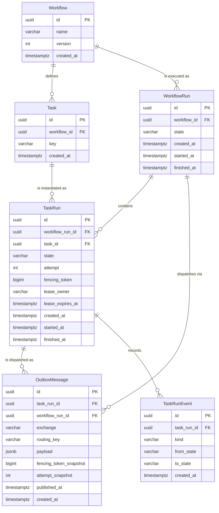

# Data Model

This document explains the durable half of the FlowForge domain: the tables in
`core/models.py`, the invariants enforced by the database, and the reason each
index exists.

The rule this document enforces: **if you cannot name the query an index serves,
the index should not exist.** Every index below is listed with its query, its
column order rationale, and whether that query exists today.

Related reading: [`execution-model.md`](execution-model.md) for the state
machines that drive these rows.

---

## Entity relationships



The two-level split matters. `Workflow` / `Task` are **definitions** — the
template. `WorkflowRun` / `TaskRun` are **executions** — one instantiation of
that template. Keeping them in separate tables is what makes "which definition
did run `abc` actually execute?" answerable years later, instead of a run
pointing at a definition that has since been edited in place.

`WorkflowRun.workflow` and `TaskRun.task` use `on_delete=PROTECT`. A definition
that has been executed cannot be deleted, because deleting it would orphan the
history that explains what happened. `TaskRun.workflow_run` uses `CASCADE`: a run
and its task runs are one unit of history, and there is no meaningful run without
them.

---

## Why UUID primary keys

All four tables use `UUIDField(primary_key=True, default=uuid.uuid4)`.

| Reason | Consequence |
| --- | --- |
| IDs are generated by the client-side worker before the row exists | A worker can stamp its own correlation ID onto a log line and a message before any round-trip; no `RETURNING id` needed to continue |
| IDs appear in URLs and API responses | Sequential integers leak run volume and invite enumeration; a UUID does not |
| IDs cross process and system boundaries | Scheduler, workers and the outbox all reference runs by ID without a shared sequence |
| Insert order is not ID order | Random UUIDv4 means insert-heavy tables do not concentrate writes on the rightmost B-tree leaf |

The cost is accepted knowingly: 16 bytes instead of 8, and a wider index. For an
orchestration engine whose bottleneck is state transitions and message delivery,
not index density, that trade is correct.

> **Not chosen: UUIDv7 / ULID.** Time-ordered IDs would give better insert
> locality, but they leak creation time and would need a custom field plus
> migration. Revisit only if `TaskRun` insert throughput becomes the measured
> bottleneck.

---

## Why `varchar` + `CHECK` instead of a native PostgreSQL enum

State is stored as `varchar(20)` with a `CHECK` constraint listing the legal
values, not as a PostgreSQL `ENUM` type.

A native enum requires `ALTER TYPE ... ADD VALUE` to add a state, which cannot run
inside a transaction on older PostgreSQL and cannot be removed at all without
recreating the type. Adding `retrying` to `TaskRunState` would be a migration
that is hard to roll back. A `CHECK` constraint is dropped and recreated in one
ordinary migration, rolls back cleanly, and shows up as readable text in `psql`
output and in a `pg_dump`.

The `choices` list on the field is **not** the enforcement mechanism — Django
validates `choices` only on full-clean model forms, never on `.update()`. The
`CHECK` constraint is what actually holds. This is why `tests/unit/test_constraints.py`
writes through `QuerySet.update()`: it proves the constraint fires when every
Python-level guard is bypassed.

---

## Constraints

Constraints are grouped by what they protect. Each row names the failure it makes
impossible.

### `Workflow`

| Name | Kind | Invariant | Failure prevented |
| --- | --- | --- | --- |
| `uniq_workflow_name_version` | Unique | `(name, version)` is unique | Two different definitions both claiming to be `etl v3`, making a run's provenance ambiguous |
| `workflow_version_positive` | Check | `version >= 1` | A `v0` or negative version that sorts before the first real definition |

### `Task`

| Name | Kind | Invariant | Failure prevented |
| --- | --- | --- | --- |
| `uniq_task_workflow_key` | Unique | `(workflow, key)` is unique | Two steps with the same name in one workflow, which makes the Phase 2 DAG's edge resolution non-deterministic |

### `WorkflowRun`

| Name | Kind | Invariant | Failure prevented |
| --- | --- | --- | --- |
| `wfrun_state_valid` | Check | `state` is one of the five declared values | A typo or a future code path writing `"suceeded"` |
| `wfrun_finished_at_matches_state` | Check | `state ∈ {succeeded, failed, cancelled}` **iff** `finished_at IS NOT NULL` | A terminal run with no finish time (every duration metric becomes wrong) and a running run with one (anything sorting by `finished_at` treats it as done) |

`wfrun_finished_at_matches_state` is written as a biconditional, not two separate
checks. Two independent checks could each pass while the row was still
inconsistent, because they would not constrain each other.

### `TaskRun`

| Name | Kind | Invariant | Failure prevented |
| --- | --- | --- | --- |
| `uniq_taskrun_per_run_task` | Unique | `(workflow_run, task)` is unique | Two rows for the same step in the same run, so "what happened to task X in run Y" stops being a single-row read. Retries reuse the row instead of inserting |
| `taskrun_state_valid` | Check | `state` is one of the seven declared values | Unknown state values |
| `taskrun_attempt_positive` | Check | `attempt >= 1` | An attempt counter that starts at 0, which makes "attempt 1" ambiguous with "never attempted" |
| `taskrun_fencing_non_negative` | Check | `fencing_token >= 0` | A negative token, which would let a stale write match a fresh row after a wrap or a bad decrement |
| `taskrun_finished_after_started` | Check | `finished_at IS NULL OR started_at IS NULL OR finished_at >= started_at` | Negative durations from clock skew or a reversed write |
| `taskrun_lease_iff_running` | Check | `state = 'running'` **iff** `lease_expires_at IS NOT NULL` | A running row with no lease (the reaper can never reclaim it, so it hangs forever) and an idle row holding a lease (the reaper reclaims work nobody owns) |

`taskrun_lease_iff_running` is the load-bearing one for liveness. Because it is
an equivalence, neither half can drift: the reaper's query
(`state='running' AND lease_expires_at < now`) is guaranteed to see every running
row.

### `OutboxMessage`

| Name | Kind | Invariant | Failure prevented |
| --- | --- | --- | --- |
| `uniq_outbox_per_taskrun_generation` | Unique | `(task_run, fencing_token_snapshot)` is unique | Two schedulers writing two dispatch rows for the same live generation, so the same task would be delivered — and executed — twice. A reaped lease bumps the fencing token, so a re-dispatch is a genuinely new generation and a new row |

The unique constraint, not a lock, is what makes "exactly one dispatch per live
generation" true: a row that does not exist yet cannot be locked, so two
first-dispatch attempts both insert and the constraint picks the winner. The
scheduler catches the conflict and skips, and no duplicate message is published.

---

## Indexes

`created_at` is used as the age proxy throughout rather than `started_at`, because
`started_at` is nullable and `created_at` is not. A sweep ordered by a nullable
column would need `NULLS LAST` handling and could not use a plain B-tree scan.

### `WorkflowRun`

| Name | Columns | Query served | Exists today? |
| --- | --- | --- | --- |
| `idx_wfrun_wf_recent` | `(workflow, created_at DESC)` | `SELECT ... WHERE workflow_id = ? ORDER BY created_at DESC LIMIT 50` — "the last N runs of this workflow" | **Yes.** Phase 3 (REST API run listing) |
| `idx_wfrun_state_age` | `(state, created_at)` | `SELECT ... WHERE state = 'running' AND created_at < now() - interval '1h'` — stuck-run sweep | **Yes.** Phase 4 (scheduler recovery) |

Column order rationale for `idx_wfrun_wf_recent`: `workflow` is the equality
predicate and comes first; `created_at DESC` is the ordering and comes second, so
the index satisfies both the filter and the `ORDER BY` without a sort. The
descending direction is declared in the index so a backward scan is not needed.

For `idx_wfrun_state_age`: equality on `state` first, then range on `created_at`.
The reverse order (`created_at, state`) would force a scan of every run in the
time window and filter afterwards.

### `TaskRun`

| Name | Columns | Query served | Exists today? |
| --- | --- | --- | --- |
| `idx_taskrun_state_age` | `(state, created_at)` | `SELECT ... WHERE state = 'ready' ORDER BY created_at LIMIT 1` — the scheduler's "oldest READY task first" claim | **Yes.** Phase 4 |
| `idx_taskrun_run_state` | `(workflow_run, state)` | `SELECT state, count(*) ... WHERE workflow_run_id = ? GROUP BY state` — run progress and terminal-state derivation | **Yes.** Phase 3/4 |
| `idx_taskrun_lease_expiry` | `(lease_expires_at)` **partial**, `WHERE state = 'running'` | `SELECT ... WHERE lease_expires_at < now()` — the lease reaper | **Yes.** Phase 4 |

`idx_taskrun_state_age` is the index the whole scheduler design depends on. The
claim loop is "find the oldest eligible task and take it", and this index makes
that a bounded index scan rather than a sequential scan with a sort. Note that
`claim_task_run()` in `core/repositories/transitions.py` currently claims by
primary key — the *selection* query is what Phase 4 adds. The index is provisioned
for it.

`idx_taskrun_lease_expiry` is **partial on `state = 'running'`** deliberately.
Running rows are a tiny fraction of a `TaskRun` table that accumulates history
forever, so a full index on `lease_expires_at` would be almost entirely `NULL`
entries — write cost on every insert, scan benefit on almost nothing. The partial
index stays proportional to in-flight work, not table size. It is also
self-vacuuming in practice: rows leave the index the moment they leave `running`.

PostgreSQL supports partial indexes directly; SQLite does too, which is why the
local test suite exercises this index rather than silently ignoring it.

### `OutboxMessage`

| Name | Columns | Query served | Exists today? |
| --- | --- | --- | --- |
| `idx_outbox_pending` | `(created_at)` **partial**, `WHERE published_at IS NULL` | `SELECT ... WHERE published_at IS NULL ORDER BY created_at LIMIT n FOR UPDATE SKIP LOCKED` — the publisher drain | **Yes.** Phase 4 |

Like the lease index, this one is **partial on `published_at IS NULL`**. Delivered
rows accumulate forever, so a full index would grow without bound for a query that
only ever looks at the undelivered tail. The partial index stays proportional to
the backlog, not to the history.

### `TaskRunEvent`

| Name | Columns | Query served | Exists today? |
| --- | --- | --- | --- |
| `idx_event_taskrun_created` | `(task_run, created_at)` | `SELECT ... WHERE task_run_id = ? ORDER BY created_at` — a run's event log (`GET /api/v1/runs/<id>/events/`) | **Yes.** Phase 7 |

`TaskRunEvent` is append-only: it is written beside every transition in
`core/repositories/transitions.py` and never updated or deleted. The composite
index serves the read endpoint's filter and ordering in one scan; the table is
history, so it grows with transitions rather than with in-flight work, and a full
scan is acceptable only because the per-run slice is what is ever queried.

### Implicit indexes and a known redundancy

Django creates a single-column index on every foreign key by default. Three of
those are **redundant** with the composite indexes above, because the FK column is
the leading column of the composite:

| Redundant index | Covered by |
| --- | --- |
| `TaskRun.workflow_run_id` | `idx_taskrun_run_state (workflow_run, state)` |
| `WorkflowRun.workflow_id` | `idx_wfrun_wf_recent (workflow, created_at DESC)` |
| `Task.workflow_id` | `uniq_task_workflow_key (workflow, key)` |

`TaskRun.task_id` is **not** redundant — no composite index leads with `task`, so
it is the only thing serving `WHERE task_id = ?`.

**Decision: keep the redundant three for now.** Dropping them means
`db_index=False` on the FK, which is a one-line change but also a migration, and
the benefit is unmeasurable without real data volume. They are cheap on tables
this size. This is a deliberate deferral, not an oversight, and it is recorded
here so it is not rediscovered as a surprise. Re-evaluate in Phase 11 with
`pg_stat_user_indexes.idx_scan` on a table of realistic size: an index showing
zero scans across a full workload is the evidence needed to drop it.

---

## How writes reach these tables

State changes to `WorkflowRun` and `TaskRun` go through
`core/repositories/transitions.py`, which issues a single conditional `UPDATE`.
The outbox is written by `core/repositories/outbox.py`: `create_dispatch` inserts
one row per generation in the same transaction as the eligibility work, and
`mark_published` stamps `published_at` only after the broker confirms. No state
change is written by a `save()`.

```sql
UPDATE core_taskrun
   SET state = 'running', fencing_token = fencing_token + 1, ...
 WHERE id = $1 AND state = 'ready';
```

The constraint set above is what makes that safe to trust. The `CHECK` constraints
cannot be bypassed by a concurrent writer, and the partial index cannot drift
because `taskrun_lease_iff_running` guarantees a lease exists exactly on running
rows.

See [`execution-model.md`](execution-model.md) for the full protocol.

---

## Migration policy

- `makemigrations --check --dry-run` runs in CI, so a model change without its
  migration fails the build.
- Constraint and index names are written explicitly, never auto-generated. An
  auto-generated name varies by Django version, which makes a later
  `RemoveConstraint` guesswork.
- Adding a constraint to a large existing table requires `NOT VALID` plus a
  separate `VALIDATE CONSTRAINT`; nothing here is large enough yet, but a future
  migration must not lock the table.
