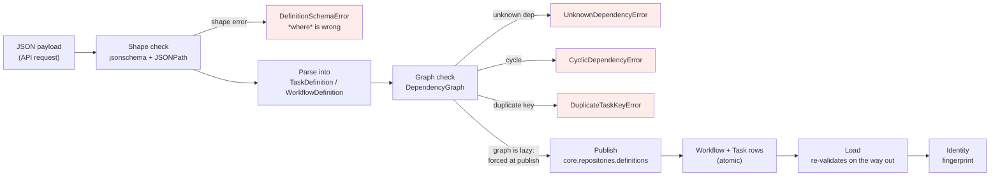

# Workflow Definitions

This document covers the half of FlowForge that decides what work exists: a
name, a version, a set of tasks, and the edges between them. It stops at the
point where execution begins — the state machines that drive a run live in
[`execution-model.md`](execution-model.md), and the rows they write live in
[`data-model.md`](data-model.md).

The question this document exists to answer is: **what makes "etl v3" mean the
same thing today, in six months, and on a machine that did not publish it?**

---

## The definition lifecycle



Two properties hold at every hop:

1. **Validation happens on the way in and on the way out.** A payload is checked
   at parse time, and a row set is checked again at load time. A definition that
   becomes unrunnable — a manual `UPDATE`, a data-loss migration, a bug in an
   earlier release — is caught when it is read, not when a scheduler later tries
   to schedule it inside a transaction.
2. **The shape error wins over the graph error.** A payload that is both
   malformed and cyclic produces the shape error, because fixing the shape is the
   cheaper of the two for the author to act on.

---

## Why definitions are value objects, not models

`TaskDefinition` and `WorkflowDefinition` are frozen dataclasses. They have no
`Meta`, no manager, and no knowledge of Django.

The alternative — a `Definition` model with methods — would put the validation
rules inside the class that also owns persistence, and the next rule to be added
would be a `save()` override. Once validation lives behind `save()`, a
`QuerySet.update()` bypasses it, and the same class of hole that
`data-model.md` closes with `CHECK` constraints reopens in Python.

The split also buys the property Phase 1 established for the state machines: the
whole rule set is testable without a database. `tests/unit/domain/test_no_framework_imports.py`
enforces it two ways — an AST scan that names the offending file and line, and a
subprocess import with `django` made unimportable, so the rule cannot be
satisfied by a static-analysis blind spot such as a dynamic import.

| Rule | Why it lives here |
| --- | --- |
| `key`/`task_type` non-blank | Cannot be a `CHECK` constraint — blank-vs-whitespace is a policy call, and the error names the task |
| `depends_on` unique per task | A duplicate entry is a harmless-looking payload that makes the graph harder to reason about |
| config is JSON-shaped | `Task.config` is a `JSONField`; a `datetime` must fail here, naming the task, not at save time |
| dependencies reference existing tasks | Not expressible as any constraint that does not scan the table |
| no cycles | Same — and it is the one rule a scheduler cannot survive |

---

## The dependency graph

`DependencyGraph` is built from the tasks and is the only place a cycle can exist
or be rejected. It is a cached property, so it is *lazy* — which is why the
parser, the publisher and the loader each force it explicitly. A graph nothing
ever builds is a graph nothing ever validates. It answers four questions, all of
which the Phase 4 scheduler needs:

| Question | Method | Used by |
| --- | --- | --- |
| In what order do I walk this? | `topological_order()` | Deterministic scheduling and export |
| What can run right now? | `ready_tasks(completed)` | The scheduler's work loop |
| What is this waiting on, transitively? | `transitive_dependencies_of()` | Explaining a task that cannot start |
| What will this unblock, transitively? | `transitive_dependents_of()` | Answering "why did this workflow stall?" |

### Why cycle detection is iterative

A recursive depth-first walk breaks at roughly 1000 frames. The test
`test_a_cycle_at_the_end_of_a_deep_chain_is_found` builds a 3000-node chain whose
back-edge sits at the far end, which is exactly where a recursive walker dies.
The implementation walks an explicit stack of `(node, next_child_index)` frames
instead, so the limit is heap size rather than interpreter stack.

This is not a theoretical preference: a workflow with a long generated dependency
chain is a plausible artifact of a customer's own codegen, and hitting it in
production should not look like a `RecursionError` in a worker.

### Determinism

`topological_order()` and `levels()` are sorted, not arbitrary. Ties are broken by
ascending task key, so the **same definition always produces the same schedule**
regardless of the order the tasks were declared in. That is what makes
`test_ordering_does_not_depend_on_declaration_order` meaningful, and it is what
lets a worker restart a run and land on the same order.

If order were left to insertion order, two databases holding the same definition
would schedule it differently, and "it worked on my machine" would be a real
class of bug rather than a joke.

---

## Shape vs graph: why two validators

A JSON payload has two independent questions to answer, and they have different
right answers.

**Shape** is answered by `Draft202012Validator` against
`WORKFLOW_DEFINITION_SCHEMA`, and reported with a JSONPath — `$.tasks[0].key`.
A caller fixing a typo in a field name needs to know *where*, and the standard
gives that for free. `additionalProperties: false` is set deliberately: a
silently-ignored `timeout` is worse than a rejected one.

**Graph** is answered by `DependencyGraph` and reported as a domain error naming
the task — `task 'load' depends on unknown task 'extract'`. JSON Schema cannot
express this. `uniqueItems` compares within one array, so it cannot catch a
duplicate key across two objects in the `tasks` array; and acyclicity is not
expressible at all in a structural schema.

The boundary is tested from both sides, including the awkward cases:

| Payload | Error |
| --- | --- |
| `tasks: []` | Shape — `$.tasks is not non-empty` |
| missing `name` | Shape — reported at `$`, not `$.name`, because that is what the standard promises |
| duplicate task keys | **Graph** — `DuplicateTaskKeyError`, which the schema does not detect |
| `depends_on: ["ghost"]` | Graph — names the missing task |
| `a -> b -> a` | Graph — `dependency cycle detected: a -> b -> a` |
| both malformed and cyclic | Shape — the cheaper fix first |

Every JSONPath above is asserted against the real standard's output. An earlier
draft of this file asserted `$.name` for a missing `name` and `$.tasks` for a
duplicate key; both were wrong, and both now have a comment saying why, so the
next person does not "fix" the test back to the wrong expectation.

---

## Identity: the fingerprint

`WorkflowDefinition.fingerprint()` is a SHA-256 over name, version, description,
and every task's key, type, sorted dependencies and frozen config. Config is
frozen recursively — mappings to tuples of pairs, lists to tuples — so two
definitions whose configs differ only in *order* fingerprint identically.

It is what makes publishing idempotent: a caller that reposts the identical
definition after a network timeout gets the existing row back rather than an
error, which is the correct answer to "did my POST succeed?".

`description` is included, and the reason is worth stating: excluding it meant
publishing a definition whose only change was the description returned the stored
row and silently discarded the new text. The caller believed one thing and the
database held another — the same failure the `(name, version)` constraint
prevents for tasks, arriving through a field nobody thought to check.
`test_a_changed_description_changes_the_fingerprint` is the regression guard.

The fingerprint is deliberately **content only**. It does not cover the row's
`id` or `created_at`, because those change on every write and would defeat the
purpose.

---

## Publishing

`publish_definition` in `core/repositories/definitions.py` is the only writer.

```python
with transaction.atomic():
    existing = (
        Workflow.objects.select_for_update()
        .filter(name=definition.name, version=definition.version)
        .select_related()
        .first()
    )
    if existing is not None:
        if _fingerprint_of(existing) != definition.fingerprint():
            raise DefinitionConflictError(existing, definition)
        return existing
    ...
```

Three properties, in the order they matter:

1. **The graph is forced before anything is written.**
   `WorkflowDefinition.graph` is a cached property — the same laziness that made
   the parser accept cyclic payloads for a while. Accessing it here is
   load-bearing, not decoration. A cyclic definition raises before a row exists.
2. **Atomic.** The workflow and its task rows appear together or not at all. A
   workflow with half its tasks would reschedule the missing ones forever.
3. **Idempotent by content, exclusive by version.** Same content returns the
   same row. Different content under the same `(name, version)` is refused,
   because a run must be able to trace itself back to exactly the definition it
   executed. Without this, "etl v3" would mean whatever was posted last.

### The race, and what it actually does

`select_for_update()` cannot lock a row that does not exist yet, and PostgreSQL
has no gap locks to make it block. So when two callers publish the same
`(name, version)` for the first time, **both see "not there"** and both insert.
The unique constraint `uniq_workflow_name_version` picks the winner; the loser's
transaction — workflow and tasks together — rolls back.

Which exception the loser sees depends on the interleaving:

| Loser saw | Exception |
| --- | --- |
| the winner's row after it committed | `DefinitionConflictError` (if content differs) or the idempotent return (if identical) |
| a unique violation on insert | `IntegrityError` |

Both are correct outcomes and both leave the database correct. A deadlock is
not: PostgreSQL would raise `OperationalError`, and
`tests/integration/test_concurrent_publish.py` deliberately does **not** accept
that as a valid loss. If a publish ever deadlocks, the test fails and says so.

> **What is not claimed.** `publish_definition` does not serialise concurrent
> first-publishes — it cannot, without either locking a whole index range or a
> retry loop. It guarantees that the *outcome* is one definition and no
> mixture, which is the property traceability actually needs. `IntegrityError`
> is a documented, caller-retryable outcome, not an unexpected failure.

---

## Loading, and why it re-validates

`load_definition` reconstructs a definition from rows: one `TaskDefinition` per
`Task`, re-sorted by `(created_at, key)` and re-frozen through the same
`TaskDefinition` constructor. The result is equal to what was published, and its
fingerprint matches.

It re-validates on the way out for one reason: **stored rows can become invalid
without the domain's help.** A manual `UPDATE` that points `depends_on` at a task
that was later deleted, or a migration that lost data, produces a row set that
would schedule a task that can never start. Forcing `.graph` before returning
turns that into an error at load time, where it is diagnosable.

Losslessness is why migration `core/0002` added `task_type`, `depends_on` and
`config` as columns. An earlier draft reconstructed `task_type` from `key` and
dropped dependencies entirely, which contradicted its own docstring: a load that
returns something *different* from what was published cannot have a meaningful
fingerprint, and idempotent republishing would have started failing on
definitions that had never changed.

`load_definition` also refuses rows whose `task_type` is blank, naming migration
`core.0002`. That state is only reachable in a database written before Phase 2,
and guessing a `task_type` would silently resurrect the bug the migration fixed.

---

## What Phase 2 does not include

Recorded so these are not rediscovered as surprises.

| Deferred to | Why |
| --- | --- |
| Phase 3 (API) | An endpoint. This phase produces the domain layer and the repository only; no URL, no serializer, no view. |
| Phase 4 (scheduler) | Executing the graph. `ready_tasks` is tested here; the loop that calls it is not written. |
| Phase 5 (handlers) | What `task_type` maps to. The definition only stores the name, and the mapping is deliberately absent. |
| Phase 4 (ADR) | Whether Celery survives the ADR decision. Phase 2 has no opinion on task dispatch. |
| — | `Workflow.description` exists and round-trips, but nothing reads it yet. |
| — | Definition validation happens per-publish. There is no background re-validation of already-published definitions, and no audit for rows that changed by hand. |

---

## Related

- [`execution-model.md`](execution-model.md) — the state machines, the fencing
  token, and the transition contract.
- [`data-model.md`](data-model.md) — the tables, their constraints, and every
  index with the query it serves.
- `core/domain/definition.py`, `core/domain/schema.py`,
  `core/repositories/definitions.py` — the implementation, all of which is
  framework-free except the repository module.
