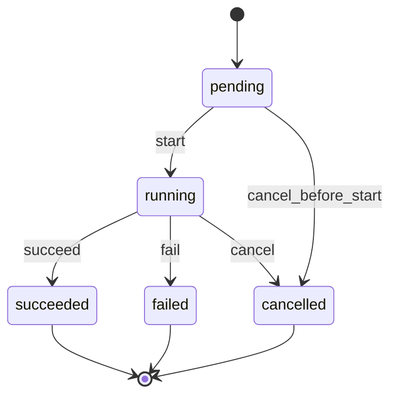
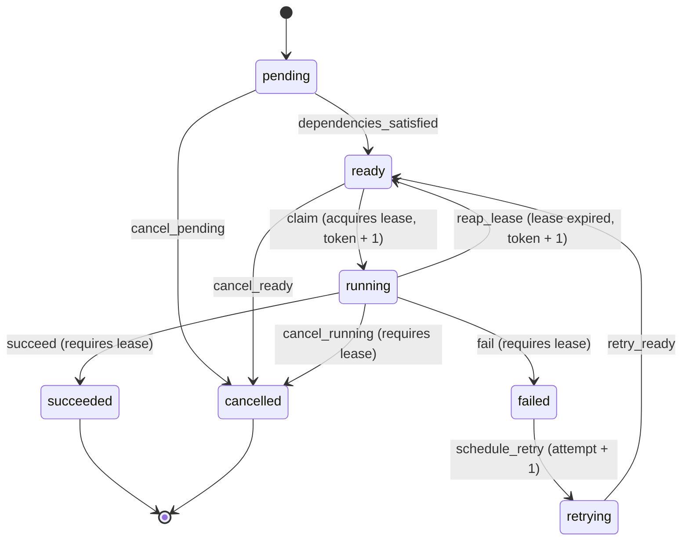
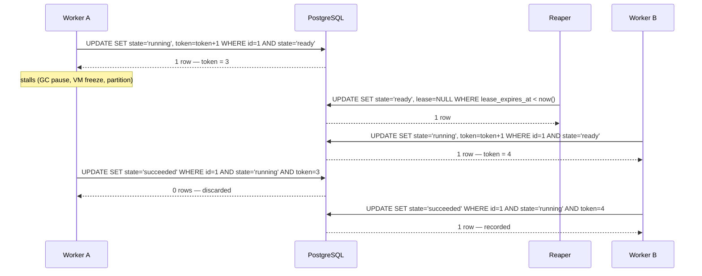

# Execution Model

This document describes how a FlowForge run actually moves through time: the two
state machines, the protocol that makes transitions safe under concurrency, and
the exact guarantees each mechanism provides.

Related reading: [`data-model.md`](data-model.md) for the tables and constraints
these transitions write to.

---

## The two state machines

Both machines are defined as **data**, not as control flow, in
`core/domain/machines.py`. A `StateMachine` holds a table of `Transition`
dataclasses and validates it at import time — duplicate edges, edges out of a
terminal state, dead ends and cross-enum states all raise `ValueError` during test
collection rather than at runtime.

### WorkflowRun



Five edges, three terminal states. A `WorkflowRun` never goes backwards and never
leaves a terminal state.

| Transition | Source | Target | Requires lease |
| --- | --- | --- | --- |
| `start` | `pending` | `running` | no |
| `cancel_before_start` | `pending` | `cancelled` | no |
| `succeed` | `running` | `succeeded` | no |
| `fail` | `running` | `failed` | no |
| `cancel` | `running` | `cancelled` | no |

### TaskRun



Ten edges, **two** terminal states. `FAILED` is deliberately *not* terminal.

| Transition | Source | Target | Requires lease |
| --- | --- | --- | --- |
| `dependencies_satisfied` | `pending` | `ready` | no |
| `cancel_pending` | `pending` | `cancelled` | no |
| `claim` | `ready` | `running` | **no** — claiming is what acquires the lease |
| `cancel_ready` | `ready` | `cancelled` | no |
| `succeed` | `running` | `succeeded` | **yes** |
| `fail` | `running` | `failed` | **yes** |
| `cancel_running` | `running` | `cancelled` | **yes** |
| `reap_lease` | `running` | `ready` | no — reachable **only** through the reaper |
| `schedule_retry` | `failed` | `retrying` | no |
| `retry_ready` | `retrying` | `ready` | no |

Three design points are worth stating explicitly, because each is a decision
someone will otherwise try to "fix":

**`claim` does not require a lease.** It cannot — acquiring the lease is the
transition. The table encodes `requires_lease=False` for `claim` and the
repository asserts the lease only on the three edges that *spend* it.

**`FAILED` is not terminal for a `TaskRun`.** A task that failed is retryable by
definition; making `failed` terminal would mean a retry had to insert a new row,
which breaks the `(workflow_run, task)` uniqueness that makes run history a
single-row read. Instead the same row moves `failed → retrying → ready` and
`attempt` increments. `SUCCEEDED` and `CANCELLED` are the only real end states.

**Cancellation is three edges, not one.** `cancel_pending`, `cancel_ready` and
`cancel_running` are distinct names because a single `cancel` name appears three
times and the table validator rejects duplicate names. The names are also more
useful in an audit log: they say *what was cancelled*, not just that a
cancellation happened.

---

## The transition protocol

Every state change is a single conditional `UPDATE`. There is no read, no
`SELECT ... FOR UPDATE`, no application-level lock, and no retry loop.

```python
TaskRun.objects.filter(pk=id, state="ready").update(state="running", ...) == 1
```

The database decides the winner. If two workers race, PostgreSQL serialises the
two `UPDATE`s on the row, the first matches `state = 'ready'` and changes it, and
the second's predicate no longer matches — it updates **zero rows**. The caller
learns it lost by the return value.

This is why the concurrency tests use `threading.Barrier` and not `sleep`: the
race is decided by row-level locking inside the database, so the test does not
need to widen a time window to provoke it. A `sleep`-based test would be both
slower and less reliable.

### The contract callers rely on

| Situation | Result |
| --- | --- |
| Transition is not in the table | `IllegalTransitionError` raised **before any SQL runs** |
| Transition is legal, this call won the race | `True` |
| Transition is legal, another writer got there first | `False` — **not** an error |
| Lease-requiring transition attempted via `transition_task_run` | `LeaseRequiredError`, pointing at `finish_task_run` |

The distinction between "illegal" and "lost the race" is the whole API. An
illegal transition is a bug in the caller and fails identically whether or not a
row exists. A lost race is normal operation under at-least-once delivery and must
not raise, or every duplicate message becomes a 500.

---

## Fencing tokens

A conditional `UPDATE` prevents two workers from claiming the same task
*simultaneously*. It does not prevent this:

1. Worker A claims task, gets token 3.
2. Worker A stalls — GC pause, VM freeze, network partition. Its lease expires.
3. The reaper reclaims the task; Worker B claims it, gets token 4.
4. Worker A wakes up and writes its result.

Worker A's write is not simultaneous with anything. It is *stale*. State alone
would not stop it, because the row is `running` again and A's
`WHERE state = 'running'` would match.

The fencing token stops it: `fencing_token` is a monotonic integer incremented
**inside the same `UPDATE` that flips the state**. Worker A's write carries
`AND fencing_token = 3`, which matches nothing, so the write is discarded instead
of overwriting a newer attempt's result.



The token is read back inside the claim transaction. That is safe specifically
because the claim `UPDATE` has already taken the row lock and moved the row out of
`ready`, so no other claim can bump the token between the `UPDATE` and the read.

`fencing_token` is `PositiveBigIntegerField`. A 64-bit counter incremented once
per claim does not overflow in any realistic lifetime.

---

## Leases

A lease is a time-bounded claim: `lease_owner` names the worker,
`lease_expires_at` bounds it. The database enforces
`state = 'running'` **iff** `lease_expires_at IS NOT NULL`
(`taskrun_lease_iff_running`), so the reaper's query
`WHERE state = 'running' AND lease_expires_at < now()` is guaranteed to see every
running row and no others.

The reaper does not need to know *why* a lease expired — crashed worker, frozen
VM, dropped network. It moves the row back to `ready`, and the fencing token
guarantees that if the original worker ever comes back, its write is harmless.
This is what turns at-least-once delivery into at-most-once *effects*.

> **Scope note:** the reaper is Phase 4 work and now exists.
> `core/repositories/transitions.py` provides `reclaim_task_run` (the conditional
> `UPDATE ... WHERE state='running' AND lease_expires_at < now`) and
> `reap_expired_leases`, and `schedule_once` runs them on every scheduler pass.
> The `reap_lease` edge is reachable **only** through `reclaim_task_run`; the
> generic `transition_task_run`/`finish_task_run` refuse it, because applying it
> there would move a row out of `running` without clearing the lease or bumping
> the token. The stale-token behaviour is proven in
> `tests/integration/test_concurrent_transitions.py::TestFencing`, and the reaper
> races in `TestLeaseReaper`.

---

## Retries

A retry reuses the row. `schedule_retry` (`failed → retrying`) increments
`attempt` and clears `finished_at`, `lease_owner` and `lease_expires_at` in the
same statement, so the row cannot be left claiming to be both finished and
in-flight.

`started_at` is **not** cleared, and `claim` writes it as
`Coalesce(started_at, now)`:

```sql
started_at = COALESCE(started_at, $now)
```

The first claim sets it; later claims preserve it. This keeps two different
metrics meaningful at once — "time to first start" (queue latency) and "time to
finish" (total latency) — instead of the second retry silently resetting the
first. `attempt` is what distinguishes the attempts; `started_at` stays the
lifecycle's origin.

---

## Deriving run state from task state

`core/domain/services.py` derives a `WorkflowRun`'s state from its `TaskRun`
states, with a fixed precedence:

1. **any `cancelled` → `cancelled`** — cancellation is a user decision and wins
   over any concurrent outcome
2. **else any `failed` → `failed`**
3. **else all `succeeded` → `succeeded`**
4. **else any `running` → `running`**
5. **else → `pending`**

Precedence 1 before 2 matters: a run cancelled while one task had already failed
should read as cancelled, because that is what the user asked for. Precedence 3
requires *all* tasks, not "no failures" — an empty run is not a success.

`initial_task_run_state(dependency_count)` returns `ready` when the count is zero
and `pending` otherwise, which is how the first tasks in a DAG become eligible
without a separate "kickoff" path.

These are pure functions with no database access, which is what lets them be
property-tested with Hypothesis against generated state sequences rather than
fixtures.

---

## Purity of the domain layer

`core/domain/` imports no Django, and this is enforced rather than documented:

- `tests/unit/domain/test_no_framework_imports.py` walks the AST of every module
  in `core/domain/` and fails on any forbidden root (`django`, `rest_framework`,
  database and broker drivers, and the rest), including imports nested inside
  functions or `try/except ImportError` blocks.
- The same test re-imports each module in a subprocess with `django` blocked on
  `sys.meta_path`, so a transitive import cannot slip through the AST check.
- The scanner is itself tested against deliberately bad source, so it cannot
  silently stop detecting things.

The payoff is that state machines, entity invariants and derivation rules are
testable in microseconds with no database, and the rules survive a change of
persistence layer or framework.

---

## Delivery guarantees (verified against RabbitMQ)

The publisher's guarantees are broker semantics, so they are tested against a real
RabbitMQ in CI (`tests/integration/test_rabbit_publisher.py`,
`REQUIRE_RABBITMQ=1`), not against a fake:

- **Publisher confirms.** A row is marked delivered only after the broker
  acknowledges the publish. A confirmed message is on a bound queue with the exact
  payload (`dispatch_id`, `task_run_id`, `task_key`, `fencing_token`).
- **Mandatory routing.** Publishing uses `mandatory=True`; an unroutable message
  (no queue bound) is returned and raises, so the outbox row stays pending instead
  of being marked delivered into the void.
- **Outage.** If the broker is unreachable, the sweep's transaction rolls back and
  every row stays pending; once the broker returns, a later sweep drains them,
  exactly once each.
- **Crash window.** A row committed before any publish is delivered by a fresh
  publisher — the outbox, not the publish, is the source of truth.
- **No duplicate publish.** Two publishers running in parallel divide the pending
  rows with `FOR UPDATE SKIP LOCKED`; each row is published by exactly one.

What is **not** claimed: exactly-once *delivery*. The broker is at-least-once, so a
redelivery is possible — for example, a publisher that crashes after the broker ack
but before `mark_published` commits will publish the same row again. The worker's
claim-based de-duplication is what makes that redelivery harmless.

### The dispatch queue is a quorum queue

The queue is declared with `x-queue-type: quorum`
(`core.broker_rabbit.DISPATCH_QUEUE_ARGUMENTS`), not as a classic durable queue.

The difference is what a *confirm* means. A classic durable queue can acknowledge a
message it has not yet flushed to disk, so an abrupt broker death (power loss,
`SIGKILL`, OOM kill) can lose a message the publisher was told was safe. A quorum
queue writes through a Raft log and fsyncs **before** confirming, so a confirmed
publish is durable by construction.

**Single-node caveat.** With one broker, a quorum queue gives crash-safe
durability, not high availability: there is no replica to fail over to, and the
queue is unavailable while the node is down. Replication needs a three-node cluster
and is out of scope for this phase.

**Migration: a queue's type cannot be changed in place.** Declaring an existing
classic queue with `x-queue-type: quorum` fails with `PRECONDITION_FAILED` (406),
and `declare_dispatch_queue` raises `QueueTypeMismatchError` carrying the
procedure rather than retrying forever. To migrate a running deployment:

1. Stop the worker and the publisher. The scheduler may keep running — it only
   writes outbox rows, which are the durable record.
2. Wait for the queue to drain, or accept the loss of unacked dispatches: the
   outbox still holds every row that was not confirmed, and it republishes them.
   Rows already confirmed but unacked are the only ones at risk, and their tasks
   are recovered by the lease reaper after it expires.
3. Delete the queue: `rabbitmqctl delete_queue flowforge.tasks`, or the management
   UI (`http://localhost:15672`, user `flowforge`).
4. Start the worker. It redeclares the queue as a quorum queue and binds it.
5. Start the publisher. Any row that was pending is delivered normally.

Doing this while the queue is non-empty is safe for *unconfirmed* rows (they are
still in the outbox) and lossy for *unacked* ones, which is why step 2 is a
decision rather than a formality.

## The worker

The worker is the process that *executes*. It consumes a dispatch, claims the task
run (READY→RUNNING, bumping the fencing token), runs a trusted handler, writes the
durable outcome, and only then acks.

**Manual ack, prefetch 1.** The channel uses `auto_ack=False` and
`basic_qos(prefetch_count=1)`, so a worker holds at most one unacked message. A
crash loses at most that one, and the broker redelivers it.

**Ack after the durable outcome.** `finish_task_run` is a committed `UPDATE`; the
ack follows it. If the write fails, the message is nacked for requeue — never
acked — so a redelivery re-attempts it.

**Trusted handlers only.** The message carries a `task_type`; the worker looks it
up in an in-process registry (`core/worker/registry.py`). Nothing in the message is
imported or executed as code. An unknown type fails the task rather than loading
anything.

**Fencing.** The claim returns the new token; `finish_task_run` requires it. A
worker whose lease was reaped writes zero rows, so a resurrected worker cannot
overwrite a newer attempt. A duplicate delivery is acked without re-executing,
because the claim only matches a READY row.

**Heartbeat.** While the handler runs, a background thread calls `renew_lease`
every `lease_seconds / 3`. If the lease was already lost (the token moved), the
renewal stops and the eventual finish is correctly rejected as stale.

**Graceful shutdown.** SIGTERM/SIGINT stop consumption after the in-flight message
is finished and acked; unacked messages are redelivered. With `prefetch=1` the
in-flight set is one message. The same signal also interrupts a reconnect wait, so
a shutdown during an outage does not block for the backoff.

**Reconnection.** `Worker.run()` is a loop, not a single `start_consuming()` call.
When the connection drops — broker restart, network partition, idle timeout — the
loop backs off exponentially (with jitter) and re-establishes the connection,
channel, queue declaration and consumer. No process restart is required, and the
backoff is capped at 30s.

The subtle part is the in-flight message. If the connection dies after the handler
ran but before the ack, the worker does **not** treat the message as done: the ack
raises, the connection is torn down, and the broker requeues the message. The task
row is already terminal, so the redelivery is claimed by nobody and acked without
re-executing. If the handler died mid-write instead, the lease expires and the
reaper retries it. Either way the outcome is at-least-once with no double
execution.

A queue-type mismatch is the one error this loop does **not** retry: it raises
`QueueTypeMismatchError` immediately, because no amount of reconnecting will turn a
classic queue into a quorum queue.

**What is not claimed.** The worker is at-least-once: a crash between the DB commit
and the ack can redeliver the message. The claim and the fencing token make the
redelivery harmless, not impossible. Handler return values are persisted
(`TaskRun.result`) but only on success; a handler whose side effect is not
idempotent can replay it, which is why `idempotency_key` exists and why the
registry is trusted-only.

## What is not here yet

Listed so the boundary is explicit rather than inferred:

- **No multi-task transaction beyond `advance_workflow_run`.** The scheduler wraps
  one run's promote-and-dispatch work in a single `transaction.atomic()`; every
  other transition is still one atomic statement.
- **No HA for the queue.** A quorum queue on one node is crash-safe, not
  failover-capable; see the caveat above.
- **No per-attempt history.** A retry reuses the row; only the current attempt and
  its outcome are stored.
