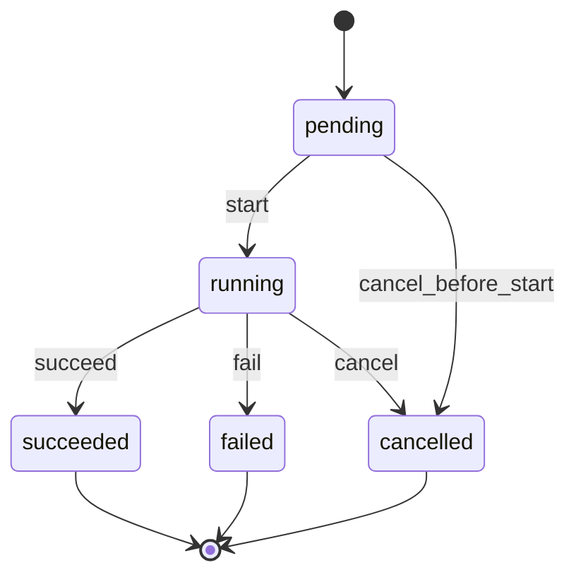
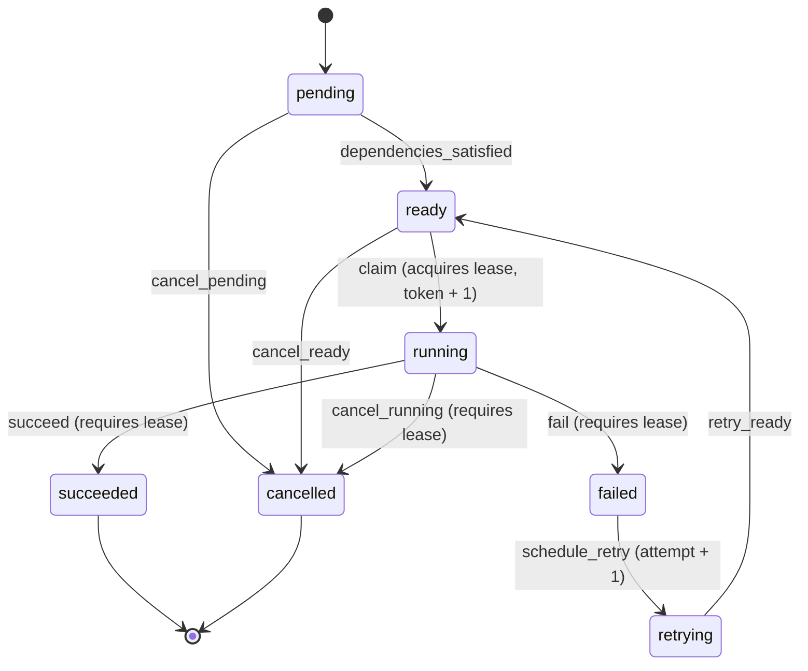
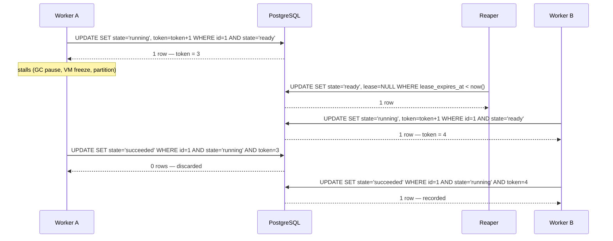

# Execution Model

This document describes how a FlowForge run actually moves through time: the two
state machines, the protocol that makes transitions safe under concurrency, and
the exact guarantees each mechanism provides.

Related reading: [`data-model.md`](data-model.md) for the tables and constraints
these transitions write to.

---

## The two state machines

Both machines are defined as **data**, not as control flow, in
`core/domain/machines.py`. A `StateMachine` holds a table of `Transition`
dataclasses and validates it at import time — duplicate edges, edges out of a
terminal state, dead ends and cross-enum states all raise `ValueError` during test
collection rather than at runtime.

### WorkflowRun



Five edges, three terminal states. A `WorkflowRun` never goes backwards and never
leaves a terminal state.

| Transition | Source | Target | Requires lease |
| --- | --- | --- | --- |
| `start` | `pending` | `running` | no |
| `cancel_before_start` | `pending` | `cancelled` | no |
| `succeed` | `running` | `succeeded` | no |
| `fail` | `running` | `failed` | no |
| `cancel` | `running` | `cancelled` | no |

### TaskRun



Nine edges, **two** terminal states. `FAILED` is deliberately *not* terminal.

| Transition | Source | Target | Requires lease |
| --- | --- | --- | --- |
| `dependencies_satisfied` | `pending` | `ready` | no |
| `cancel_pending` | `pending` | `cancelled` | no |
| `claim` | `ready` | `running` | **no** — claiming is what acquires the lease |
| `cancel_ready` | `ready` | `cancelled` | no |
| `succeed` | `running` | `succeeded` | **yes** |
| `fail` | `running` | `failed` | **yes** |
| `cancel_running` | `running` | `cancelled` | **yes** |
| `schedule_retry` | `failed` | `retrying` | no |
| `retry_ready` | `retrying` | `ready` | no |

Three design points are worth stating explicitly, because each is a decision
someone will otherwise try to "fix":

**`claim` does not require a lease.** It cannot — acquiring the lease is the
transition. The table encodes `requires_lease=False` for `claim` and the
repository asserts the lease only on the three edges that *spend* it.

**`FAILED` is not terminal for a `TaskRun`.** A task that failed is retryable by
definition; making `failed` terminal would mean a retry had to insert a new row,
which breaks the `(workflow_run, task)` uniqueness that makes run history a
single-row read. Instead the same row moves `failed → retrying → ready` and
`attempt` increments. `SUCCEEDED` and `CANCELLED` are the only real end states.

**Cancellation is three edges, not one.** `cancel_pending`, `cancel_ready` and
`cancel_running` are distinct names because a single `cancel` name appears three
times and the table validator rejects duplicate names. The names are also more
useful in an audit log: they say *what was cancelled*, not just that a
cancellation happened.

---

## The transition protocol

Every state change is a single conditional `UPDATE`. There is no read, no
`SELECT ... FOR UPDATE`, no application-level lock, and no retry loop.

```python
TaskRun.objects.filter(pk=id, state="ready").update(state="running", ...) == 1
```

The database decides the winner. If two workers race, PostgreSQL serialises the
two `UPDATE`s on the row, the first matches `state = 'ready'` and changes it, and
the second's predicate no longer matches — it updates **zero rows**. The caller
learns it lost by the return value.

This is why the concurrency tests use `threading.Barrier` and not `sleep`: the
race is decided by row-level locking inside the database, so the test does not
need to widen a time window to provoke it. A `sleep`-based test would be both
slower and less reliable.

### The contract callers rely on

| Situation | Result |
| --- | --- |
| Transition is not in the table | `IllegalTransitionError` raised **before any SQL runs** |
| Transition is legal, this call won the race | `True` |
| Transition is legal, another writer got there first | `False` — **not** an error |
| Lease-requiring transition attempted via `transition_task_run` | `LeaseRequiredError`, pointing at `finish_task_run` |

The distinction between "illegal" and "lost the race" is the whole API. An
illegal transition is a bug in the caller and fails identically whether or not a
row exists. A lost race is normal operation under at-least-once delivery and must
not raise, or every duplicate message becomes a 500.

---

## Fencing tokens

A conditional `UPDATE` prevents two workers from claiming the same task
*simultaneously*. It does not prevent this:

1. Worker A claims task, gets token 3.
2. Worker A stalls — GC pause, VM freeze, network partition. Its lease expires.
3. The reaper reclaims the task; Worker B claims it, gets token 4.
4. Worker A wakes up and writes its result.

Worker A's write is not simultaneous with anything. It is *stale*. State alone
would not stop it, because the row is `running` again and A's
`WHERE state = 'running'` would match.

The fencing token stops it: `fencing_token` is a monotonic integer incremented
**inside the same `UPDATE` that flips the state**. Worker A's write carries
`AND fencing_token = 3`, which matches nothing, so the write is discarded instead
of overwriting a newer attempt's result.



The token is read back inside the claim transaction. That is safe specifically
because the claim `UPDATE` has already taken the row lock and moved the row out of
`ready`, so no other claim can bump the token between the `UPDATE` and the read.

`fencing_token` is `PositiveBigIntegerField`. A 64-bit counter incremented once
per claim does not overflow in any realistic lifetime.

---

## Leases

A lease is a time-bounded claim: `lease_owner` names the worker,
`lease_expires_at` bounds it. The database enforces
`state = 'running'` **iff** `lease_expires_at IS NOT NULL`
(`taskrun_lease_iff_running`), so the reaper's query
`WHERE state = 'running' AND lease_expires_at < now()` is guaranteed to see every
running row and no others.

The reaper does not need to know *why* a lease expired — crashed worker, frozen
VM, dropped network. It moves the row back to `ready`, and the fencing token
guarantees that if the original worker ever comes back, its write is harmless.
This is what turns at-least-once delivery into at-most-once *effects*.

> **Honest scope note:** the reaper itself is Phase 4 work. Phase 1 provides the
> schema, the constraint, the index and the fencing mechanism; there is no
> background reaper loop in the codebase yet. The stale-token behaviour is proven
> in `tests/integration/test_concurrent_transitions.py::TestFencing`.

---

## Retries

A retry reuses the row. `schedule_retry` (`failed → retrying`) increments
`attempt` and clears `finished_at`, `lease_owner` and `lease_expires_at` in the
same statement, so the row cannot be left claiming to be both finished and
in-flight.

`started_at` is **not** cleared, and `claim` writes it as
`Coalesce(started_at, now)`:

```sql
started_at = COALESCE(started_at, $now)
```

The first claim sets it; later claims preserve it. This keeps two different
metrics meaningful at once — "time to first start" (queue latency) and "time to
finish" (total latency) — instead of the second retry silently resetting the
first. `attempt` is what distinguishes the attempts; `started_at` stays the
lifecycle's origin.

---

## Deriving run state from task state

`core/domain/services.py` derives a `WorkflowRun`'s state from its `TaskRun`
states, with a fixed precedence:

1. **any `cancelled` → `cancelled`** — cancellation is a user decision and wins
   over any concurrent outcome
2. **else any `failed` → `failed`**
3. **else all `succeeded` → `succeeded`**
4. **else any `running` → `running`**
5. **else → `pending`**

Precedence 1 before 2 matters: a run cancelled while one task had already failed
should read as cancelled, because that is what the user asked for. Precedence 3
requires *all* tasks, not "no failures" — an empty run is not a success.

`initial_task_run_state(dependency_count)` returns `ready` when the count is zero
and `pending` otherwise, which is how the first tasks in a DAG become eligible
without a separate "kickoff" path.

These are pure functions with no database access, which is what lets them be
property-tested with Hypothesis against generated state sequences rather than
fixtures.

---

## Purity of the domain layer

`core/domain/` imports no Django, and this is enforced rather than documented:

- `tests/unit/domain/test_no_framework_imports.py` walks the AST of every module
  in `core/domain/` and fails on any forbidden root (`django`, `rest_framework`,
  `celery`, and the rest), including imports nested inside functions or
  `try/except ImportError` blocks.
- The same test re-imports each module in a subprocess with `django` blocked on
  `sys.meta_path`, so a transitive import cannot slip through the AST check.
- The scanner is itself tested against deliberately bad source, so it cannot
  silently stop detecting things.

The payoff is that state machines, entity invariants and derivation rules are
testable in microseconds with no database, and the rules survive a change of
persistence layer or framework.

---

## What Phase 1 does not include

Listed so the boundary is explicit rather than inferred:

- No scheduler loop, no outbox, no message publishing (Phase 4).
- No lease reaper process (Phase 4) — only the schema, constraint and index.
- No DAG or dependency resolution (Phase 2) — `dependency_count` is an input,
  not something the domain computes yet.
- No REST endpoints for runs (Phase 3).
- No transaction boundary wrapping a *multi-task* change. Each transition is one
  atomic statement; a workflow-level operation that must move several rows
  atomically is Phase 4 work and will need an explicit `transaction.atomic()`
  block plus a documented ordering rule to avoid deadlocks.
