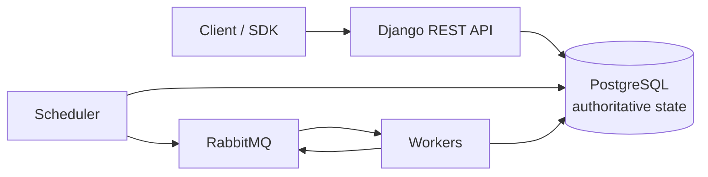

# FlowForge

A distributed workflow orchestration engine for DAG-shaped jobs, built on Django,
PostgreSQL, RabbitMQ and Redis.

FlowForge aims to make the *hard* parts of distributed execution explicit —
leases, fencing tokens, a transactional outbox and at-least-once delivery —
instead of hiding them behind a task decorator.

!!! warning "Status: Phase 2 of 11"

    A workflow can be described, validated and published, and the rules that will
    drive execution exist as pure Python with database constraints behind them.
    **Nothing runs a workflow yet**: there is no API, no scheduler and no worker
    loop. Every document here states what is implemented and what is not.

## Where to start

- **Understand the design**

    ---

    The data model, the state machines, and the definition engine — each written
    down before it was built.

    [:octicons-arrow-right-24: Architecture](architecture/overview.md)

- **Run it locally**

    ---

    Docker Compose, or a local `uv` environment. Both are verified in CI.

    [:octicons-arrow-right-24: Setup](development/setup.md)

- **See what is actually done**

    ---

    Per-phase status, verification links to the CI runs, and an explicit list of
    known limitations.

    [:octicons-arrow-right-24: Progress](development/PROGRESS.md)

- **Read the decisions**

    ---

    Every non-obvious choice, with the alternative that was rejected and why.

    [:octicons-arrow-right-24: Decisions](development/DECISIONS.md)

## The shape of the thing

PostgreSQL is the single source of truth. A broker message is a *hint* that work
may be available; the row is the decision. That ordering is what makes
at-least-once delivery safe and exactly-once delivery unnecessary to promise.

## Principles

- **The database decides.** State changes are conditional `UPDATE`s that report
  whether they won, not read-then-write sequences that assume they did.
- **A lost race is not an error.** It is a `False` return, and the caller decides
  what to do about it.
- **Validate on the way in and on the way out.** A definition that becomes
  unrunnable is caught when it is read, not when a scheduler tries to run it.
- **No claim without evidence.** Every verification section links to a CI run.
