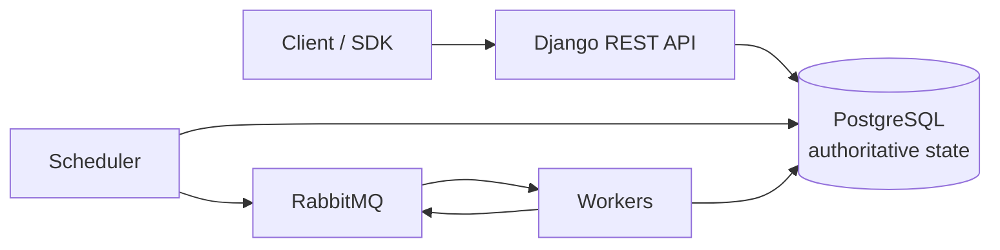

# FlowForge

A distributed workflow orchestration engine for DAG-shaped jobs, built on Django,
PostgreSQL, RabbitMQ and Redis.

FlowForge aims to make the *hard* parts of distributed execution explicit —
leases, fencing tokens, a transactional outbox and at-least-once delivery —
instead of hiding them behind a task decorator.

!!! success "Status: v1.0.0 released — all 11 phases implemented"

    Every layer is built and exercised end to end in CI: the REST API and the
    Python SDK/CLI, the scheduler and its transactional outbox, the publisher,
    the worker with leases and fencing tokens, retries and dead-lettering,
    multi-tenancy with RBAC and an append-only audit log, observability, and the
    operational surface (Kubernetes, backups with a restore drill, HA guidance).

    **What it guarantees.** *At-least-once delivery*: a broker message is only a
    hint, and the row is the decision, so a lost message is recoverable. *Fencing
    tokens*: a worker that lost its lease cannot write over the current owner.
    *A transactional outbox*: a dispatch exists if and only if the state change
    that required it committed.

    **What it does not guarantee.** *Exactly-once execution.* A handler can run
    more than once across a crash, which is why handlers should be idempotent and
    the API offers opt-in idempotency keys. Nothing here claims otherwise.

    Every failure mode is mapped to a named test in the
    [failure model](architecture/failure-model.md), with the untested ones marked
    UNVERIFIED; the [known limitations](development/PROGRESS.md#known-limitations)
    list what is deliberately not proven.

## Where to start

-   **Understand the design**

    ---

    The data model, the state machines, and the definition engine — each written
    down before it was built.

    [:octicons-arrow-right-24: Architecture](architecture/overview.md)

-   **Run it locally**

    ---

    Docker Compose, or a local `uv` environment. Both are verified in CI.

    [:octicons-arrow-right-24: Setup](development/setup.md)

-   **See what is actually done**

    ---

    Per-phase status, verification links to the CI runs, and an explicit list of
    known limitations.

    [:octicons-arrow-right-24: Progress](development/PROGRESS.md)

-   **Read the decisions**

    ---

    Every non-obvious choice, with the alternative that was rejected and why.

    [:octicons-arrow-right-24: Decisions](development/DECISIONS.md)

## The shape of the thing

PostgreSQL is the single source of truth. A broker message is a *hint* that work
may be available; the row is the decision. That ordering is what makes
at-least-once delivery safe and exactly-once delivery unnecessary to promise.

## Principles

- **The database decides.** State changes are conditional `UPDATE`s that report
  whether they won, not read-then-write sequences that assume they did.
- **A lost race is not an error.** It is a `False` return, and the caller decides
  what to do about it.
- **Validate on the way in and on the way out.** A definition that becomes
  unrunnable is caught when it is read, not when a scheduler tries to run it.
- **No claim without evidence.** Every verification section links to a CI run.
